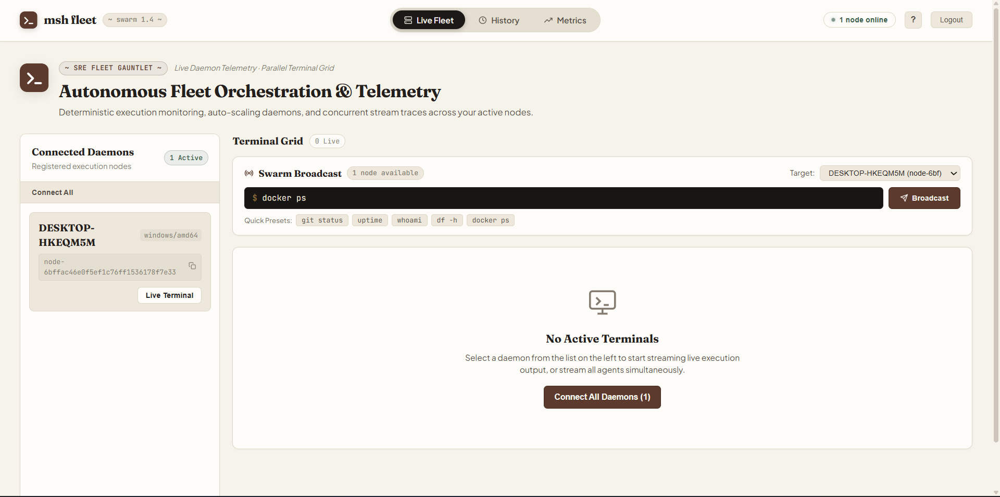

<p align="center">

</p>

<h1 align="center">msh</h1>

<p align="center">
<b>Deterministic execution runtime for AI coding agents.</b><br>
Auto-handles prompts, truncates output, redacts secrets, and lets you undo agent changes.
</p>

<p align="center">
<a href="https://github.com/msh-protocol/msh/actions/workflows/ci.yml"></a>
<a href="https://github.com/msh-protocol/msh/releases"></a>
<a href="LICENSE"></a>
<a href="https://pypi.org/project/msh-protocol/"></a>
<a href="https://www.npmjs.com/package/@msh-protocol/client"></a>
</p>

<p align="center">

</p>

---

## Why msh?

Raw shell execution breaks when agents run unattended:

- Interactive prompts (`[y/N]`, passwords) hang the agent forever
- Large compiler or test dumps blow the context window
- Secrets leak into model history
- Bad edits have no clean undo
- ANSI noise pollutes output

`msh` sits between the agent and the OS. It returns structured, bounded, redacted results and records what changed so you can reverse it.

---

## Quick Start

### 1. Install

**macOS / Linux**
```bash
curl -fsSL https://raw.githubusercontent.com/msh-protocol/msh/main/scripts/install.sh | bash
```

**Windows**
```powershell
irm https://raw.githubusercontent.com/msh-protocol/msh/main/scripts/install.ps1 | iex
```

**Go**
```bash
go install github.com/msh-protocol/msh/cmd/msh@latest
```

### 2. Teach your agent

```bash
npx skills add msh-protocol/msh --skill msh --yes
# or
msh init
```

---

## Core Commands

### Run a command
```bash
msh git status
msh npm run build
msh pytest -v
```

Outputs are sanitized, truncated, secret-redacted, and prompts are auto-handled.

```bash
msh --max-lines 500 git log
msh --timeout 1m python script.py
msh --pty npm test
```

### Undo agent changes
```bash
msh undo                  # last run
msh undo 42               # specific run
msh undo 42 --file src/index.ts
```

### Guardrails
```bash
msh guard check "rm -rf /"
msh guard list
msh --strict-workspace "cat ../../etc/passwd"
```

### Shadow worktrees
```bash
msh branch create hypo-cache
msh branch run hypo-cache "npm test"
msh branch diff hypo-cache
msh branch merge hypo-cache -m "verified"
# or
msh branch abort hypo-cache
```

### MCP server
```json
{
  "mcpServers": {
    "msh": {
      "command": "msh",
      "args": ["mcp"]
    }
  }
}
```

### Fleet dashboard
```bash
msh fleet start
```
Opens `http://localhost:9000`.

---

## SDKs

**Python**
```bash
pip install msh-protocol
```
```python
from msh import exec
res = exec("npm test", max_output_lines=200)
```

**TypeScript**
```bash
npm install @msh-protocol/client
```
```typescript
import { exec } from '@msh-protocol/client';
const res = await exec('git status');
```

**JSON mode**
```bash
msh exec "npm run build" --max-lines 500
```

---

## What it handles

| Problem | Raw shell | msh |
|---|---|---|
| Interactive prompts | Hangs | Auto-answers or blocks cleanly |
| Large logs | Blows context | Truncates (head + tail) |
| Secrets in output | Leaked | Redacted |
| Bad file edits | Manual fix | `msh undo` |
| ANSI noise | Corrupts output | Stripped |
| Destructive commands | Runs | Blocked by guardrails |
| Tool calling | Free text | Structured JSON |

---

## License

Apache 2.0
